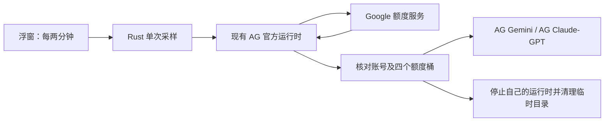

# Gemini 无感额度探测

## 当前状态

用户已确认将 AG 取数改为「QuoDex 按需启动已安装的官方运行时，读取后退出」。本轮只修复探针；沿用已批准的双舷窗和任务环。来源代码为 `2feb51e`，安装包版本仍为 0.4.15。

- **AG 取数：Verified。** Windows / Antigravity Desktop 2.35.1，Models 关闭时，正式 Rust 入口和实际浮窗均取得两个模型组各自的五小时、周额度。一次最小真实聊天后的变化也已读取。
- **AG 余额一致性：Blocked。** 安装版自动刷新已验证，但同一官方接口返回值回跳，尚未找到稳定对齐官方面板的办法。
- **Gemini Web：Blocked。** 专用网页登录未连接，当前为 QGM-211；本轮没有取得网页仓的后台真实账号证据，不能声称三仓均已解决。

具体步骤、读数、产物指纹和限制集中记录于[本轮验收记录](../../verification/gemini-live/native-probe-2026-11-26.md)。此前调研保留在[七个项目代码对照](../../research/gemini-background-probe/github-source-audit.md)，此前 Python 实验不作为运行依赖。

## 已确认的路径和根因

旧正式入口 `desktop_status()` 只检查进程，桌面运行就固定返回 QGM-232。AG 2.35.1 将本机会话参数从命令行移入子进程环境，并在启动后清除；直接连接现有桌面实例的实验收到 401。

新入口使用现有安装目录的 `language_server.exe`，沿用其普通 Desktop 认证模式。Google 账号登录由该官方程序管理。QuoDex 不读取其他进程的令牌，不安装扩展、桥或 CLI。`--headless` 会选择另一套 CLI 文件认证，因此不使用。按需启动不会显示命令窗口，也不打开 Models。

## 实现边界

1. 从标准安装位置读取 `app.asar` 中的版本、本机证书以及相邻官方 EXE。已验证 2.35.1；非标准安装路径及其他安装包布局未验证。未宣称通过发布者数字签名校验。
2. 每次使用新的随机本机会话参数、随机临时目录和 Windows Job Object。用户原有 Antigravity 保持运行。只停止自己创建的服务，正常退出清理自己的 UUID 目录；进程异常退出时由 Job Object 终止子进程。
3. HTTPS 固定为 127.0.0.1，核对监听 PID，禁用代理及重定向。信任安装包内证书，保留证书链和主机名校验。启动、网络、响应体大小均有上限。
4. 调用 `GetUserStatus` → `RetrieveUserQuotaSummary(forceRefresh=true)` → `GetUserStatus`。账号前后不一致则拒绝本次结果。持久随机盐生成账号化名，不记录邮箱、认证凭据或完整服务日志。
5. 只读取 `gemini-5h`、`gemini-weekly`、`3p-5h`、`3p-weekly`。缺失、重复、禁用、矛盾和非法数值不会变成 0% 或 100%；额外模型组不合并。未披露的 resetTime 不推算。
6. AG 两分钟、Web 五分钟，独立在途请求。多个窗口在五秒内复用同一结果并保留原时间。429 按 Retry-After 等待；其他错误给出稳定 QGM 诊断。沿用已有可见性恢复及重置点触发。
7. 同一运行会话的旧值由前端保留并标旧；未实现跨重启额度快照缓存、原生电源恢复通知或所有错误的指数退避，不将这些列为已交付功能。

## 本轮验收

先让 AG 保持普通聊天页，启动干净配置的正式发布 EXE，确认四个 AG 读数；发送仅回复 OK 的最小聊天，重新读取变化；再打开 Models 人工对照，随后关闭设置返回聊天。检查连续自动刷新，并原位安装本轮安装包、重新启动。

实际收到过 72.4154% 与 71.467453% 两种 Gemini 周余额。单进程连续请求、显式 request 字段及短延迟实验没有证明固定等待能消除差异，因此没有添加任意延迟或压低读数的补丁。安装版首次读到 71.467453%，官方面板显示 71%；五小时为 98.99333%，官方显示 99%。下一轮自动采样回跳至 72.4154%。接口完成时间只代表 QuoDex 收到响应的时间。

AG 完全退出、登录撤销、长时间令牌续期和自然重置尚未实机验收；不关闭用户的 Antigravity 来代替用户操作。Gemini Web 的首次登录与后台刷新另行验证，不能用 AG 的结果填 Web 仓。
