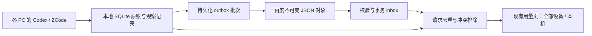

# remote-record：个人用量账本跨 PC 同步

本文件是唯一当前状态与决策入口。日期：2026-10-13（Asia/Shanghai）。分支 `remote-record`，设计基线 `953f9c21c65594615633e4296daad0ff23fd27a1`，产品版本 0.4.2；最终源码版本见本地提交记录，验证程序 SHA256 见 [原生产物报告](../../verification/remote-record/report.json)。

**本地交付：Acceptance pending。百度实网与双物理 PC 验证：Blocked。** 用户明确要求先开发、暂不连接网盘。本轮没有填写真实网盘凭据、执行实际网盘授权或上传；未 push。以下本地检查不能替代百度实网验收。

## 已确认的产品合同

- 同一人在多台办公 PC 使用 QuoDex，汇总 Codex + ZCode 已留存 token 历史，不按供应商账号拆分，不汇总账号剩余额度。
- 使用百度网盘官方 API 和用户自有个人应用，每台独立授权同一账号、同一应用目录；无需维护后台服务。
- 仅传输匿名请求摘要、时间、token 向量及合并所需元数据。不传聊天、项目路径、供应商 API key。首期不做端到端加密。
- 相同请求只计一次；无法可靠排序的不同观察保留证据、暂不计入全部设备小计，显示争议数量。本机视图保留本机账目。
- 日期统一 Asia/Shanghai；在线目标约 60 秒同步，失败指数退避至 15 分钟；离线保留账目，恢复补传。时间目标不是百度 SLA。
- UI 方向 A：扩展现有用量页的“全部设备 / 本机”，详情进入二级，百度配置使用独立 Tauri 设置窗口。用户已明确授权按方案开发，最终产品界面待用户验收。

三条核心旅程：配置并授权同一账本；各机采集并最终汇总；离线、失效或冲突时保留账目并恢复。首期不做自建后台、团队账户、多网盘插件、费用推算、聊天同步、远端自动删除和垃圾回收。所有设备都已删除且从未入账的历史无法恢复。

## 三个子代理的代码级调研

| 子代理 | 项目及调研时 stars 快照 | 实读与采用结论 |
| --- | --- | --- |
| research_usage | ccusage 18,986；CodexBar 22,427 | parser/replay、ZCode loader、request ledger、SSH export、CloudKit；采用请求身份与争议小计，不照搬 iCloud。[报告](usage.md) |
| research_sync | Joplin 56,706；Syncthing 89,343；Actual 29,463 | 上传/列表、锁、版本向量、事务日志；采用不可变对象和事务导入，不同步运行中的 SQLite 文件。[报告](sync.md) |
| research_backend | PocketBase 61,384；PostgREST 27,711；Supabase 111,443 | 批量事务、权限、JWT、SQL upsert；Supabase 实现追到 PostgREST。无中心计算需求，不引入常驻服务。[报告](backend.md) |

各报告含固定版本、源文件、license、维护活动、安全边界和适配成本。7 个项目深入源码，Supabase 另追踪平台与 PostgREST；没有运行上游测试，也没有复制 AGPL 实现。选择百度作文件存储、QuoDex 作合并；P2P 需重叠在线，CloudKit 有平台绑定，数据库服务增加运维。

补充实施证据：[ZCode 3.15.1 原生身份生成逻辑](zcode-installed-evidence.md)、[百度接口字段与未决实网约束](baidu-contract.md)。ZCode 仅阅读安装程序代码，没有读取个人聊天内容。

## 实现与数据流



| 文件 | 职责 |
| --- | --- |
| `usage_sync.rs` | 附加同步表、匿名身份、观察链、批次、收件去重、全设备汇总 |
| `sync_engine.rs` | 空间发现、有限批次往返、上传回包丢失恢复、设备最后上传时间 |
| `baidu_sync.rs` | 官方设备码、刷新、文件列表/上传/下载；响应限长与下载主机校验 |
| `sync_runtime.rs` | 单工作线程、凭据库、刷新意图、退避、取消、界面状态及上次有效读数 |
| `usage_ledger/service/sources.rs` | 原账与观察事务、来源身份映射、采集串行、上海日期 |
| `usage_server.rs` / `lib.rs` | 本机页面与受限原生桥、独立设置窗口 |
| `SyncSettings.tsx` / `usage-page/` | 连接表单、范围切换、同步详情、异常说明 |

### 身份、更新和迁移

Codex 使用规范化 JSON 元组 `(source, thread_id, response_id)` 的 SHA256；ZCode 使用 `(source, session_id, model_usage.id)` 的 SHA256，设备 ID 不加入业务去重键。原始字符串不会写入远端批次。摘要是匿名化与完整性手段，不是对可信网盘成员的密码学身份认证。

ZCode 安装包证明默认 session/message 身份为随机 UUID，model_usage 使用消息/调用身份；没有可据以跨设备比较的新旧 revision，`completed_at` 不能代替它。同一采集者的后续观察引用前驱，逆序到达需等待前驱；不同采集者有效末端不一致或同一采集者分叉时排除争议。Codex 比较完整 token 向量，相同 total 但不同分项仍是冲突。

同步表是原 SQLite 的增量扩展，保留原 usage_events。原账和观察一起事务写入；Codex 写入失败不推进扫描戳。旧 ZCode 记录只有重新读到原生身份才可映射，来源已清理且身份不明的历史继续保留本机，全部设备显示排除数量。没有提供独立 schema 回滚/自动备份工具；不能把保留旧表等同于已验证降级迁移。

### 从设计草案收敛后的协议

- 固定入口 `/apps/<官方应用目录>/QuoDex/space-v1.json`，含空间 UUID、协议与最低读写版本；不覆盖创建，竞争或回包不确定时读回检查，错误空间暂停。
- 首期批次平铺同目录，名为 `<observer UUID>_<batch UUID>.json`。采用持久化 observer 加随机批次 UUID，保留重启后的因果链；不再引入草案中的每进程 epoch、分片目录和 gzip。备份克隆产生的链分叉按争议处理，不以时钟择胜。
- 每批至多 1,000 条、1 MiB；先持久化再上传，同一批重试不改名。远端返回成功不确定时读回相同内容后才确认；接收记录不再次上传。
- inbox 标记与完整批次应用在同一事务。重复导入无副作用；坏校验、未知 schema、缺前驱均不假装完成。未来协议暂停远端操作，继续本机采集。
- 每周期最多导入 100 个、上传 16 个批次。列表按 1,000 条分页、最多 100 页，超限 QDS-108；后续周期重新列表而非永久最大序号游标。下载未完显示追赶状态。
- 设备列表由批次 observer 和服务端修改时间派生，没有单独设备注册服务或上传主机名。一次成功只说明本轮可见对象，离线设备的新账仍未知。

这里的平铺目录和每次汇总读取历史是首期规模边界；尚未做年度数据性能测试，没有宣称无限扩展。缓存/推理是细分，不再加到原 total 中。

### 凭据与本机边界

AppKey、SecretKey 和 token 只经受限 Tauri 设置窗口传给 Rust，由 keyring 存入 Windows 凭据库/macOS Keychain；普通用量网页不接收密钥或授权链接。SecretKey 仅用于百度授权，不随账本同步。

刷新在单线程执行；先保存刷新意图，再调用单次 refresh token，再保存整份新凭据。中断后不盲目重用旧 token，要求重新授权。断开使本机同步停用、移除凭据，保留历史；不声称同时撤销百度端授权。

用量 HTTP 只监听 loopback，校验 Host/Origin，变更请求必须带随机能力令牌。敏感命令限 `sync-settings` 原生窗口。下载限定 HTTPS 官方 PCS 主机、检查重定向，错误不回显 token 或原始敏感 URL。

| 诊断码 | 处理方向 |
| --- | --- |
| QDS-101 / 102 | 重新授权 / 检查应用配置或目录权限 |
| QDS-103 / 104 | 网络或对象暂不可见 / 百度返回拒绝，保留服务错误数字 |
| QDS-105 / 106 | 内容或校验异常 / 网盘空间不足 |
| QDS-107 / 108 | 空间不匹配 / 对象规模超过首期上限 |
| QDS-109 / 110 | 本地数据库保存或读取失败 / 升级协议版本 |
| QDS-111 / 112 | 系统凭据库异常 / 拒绝不可信下载地址 |
| QDS-113 / 114 | 原生窗口或操作桥异常 / 操作取消 |

## 本地验证证据

环境：Windows 11 Pro for Workstations 26200、PowerShell 7.6.5、Node 24.18.0、Rust 1.97.1。原生程序为 `src-tauri/target/debug/codex-credits-view.exe`，内含构建后的 React 资源，不是 Vite 组件预览。

复现命令（仓库根目录）：

```powershell
npm test -- --run
cargo test --manifest-path src-tauri/Cargo.toml --lib
npm run tauri -- build --debug --no-bundle
node scripts/verify-remote-record.mjs
```

本次 Rust：158 通过、0 失败、4 忽略。忽略的是既有真实桌面会话/个人登录环境检查，不计为通过。前端：14 文件、175 测试通过。构建及原生冒烟结果见 [报告](../../verification/remote-record/report.json)；详细命令日志留在本机忽略目录 `.scratch/remote-record/`。

有意义的边界覆盖：两套离线本地账本合并、共享请求去重、同 total 不同向量争议、ZCode 前驱逆序、上传成功回包丢失后的重启、损坏对象事务不推进、未知协议/空间拒绝、上海午夜、2,501 条拆为 1,000/1,000/501 且确认后不漏账。凭据测试用随机独立条目验证 Windows 安全存储读写删除及刷新意图顺序；HTTP 合约测试仅访问本机伪服务，验证 multipart、MD5、授权 pending 与错误脱敏，不能证明百度接受请求。

原生冒烟使用临时合成来源和配置目录：18,831,000 = Codex 12,035,000 + ZCode 6,796,000。验证本机/全部设备切换、403 防护、原生密钥掩码、非法目录在联网前拒绝、390px 无整页横滚、断开后账本保留。独立设置窗口通过真实 WebView2 截图；用量页由真实 Rust 服务提供。

- [桌面统计](../../verification/remote-record/usage-desktop.png)
- [窄屏统计](../../verification/remote-record/usage-narrow.png)
- [同步详情](../../verification/remote-record/sync-details.png)
- [原生连接窗口](../../verification/remote-record/connection-native.png)
- [原生错误状态](../../verification/remote-record/connection-validation-native.png)
- [设计说明](ui-brief.md)及[效果图](ui-review.png)；独立视觉复核见 [复核记录](../../verification/remote-record/ui-review.md)

原生 QA 曾遇 Windows 创建窗口线程阻塞及 WebView2 高权限进程忽略环境调试参数。已改为从阻塞工作线程创建窗口；仅 debug 构建、显式 QA 参数和隔离数据目录开启设置窗口 CDP。没有修改系统注册表或正式发布的调试设置。[WebView2 上游问题](https://github.com/MicrosoftEdge/WebView2Feedback/issues/5645)

## 已知限制与下一关

1. 尚未执行百度真实授权、刷新、目录竞争、分页往返、限流和跨 PC 同步，不能宣称已具备经过实网验收的百度同步能力。官方 precreate 文档对不覆盖 `rtype=0` 的列举存在歧义；当前失败即停止，绝不偷偷改成覆盖。真实 CDN 主机兼容性也需检查。
2. 两台 PC 分别授权同一 AppKey 是否互不失效尚未验证；需要 A 授权、B 授权、交替刷新及单端重授权的完整实测。这是百度路线放行条件。
3. 本次只在 Windows 验证；macOS 构建及 Keychain 未验证，双物理 PC 未验证。授权等待/已连接状态有组件测试，尚无真实百度授权后的原生截图。
4. 尚未做年度规模、长期频控和源日志所有版本组合的试验。首期无远端删除/压缩，无人工裁决冲突界面，争议以明确排除提示呈现。

下一步先由用户验收本地界面及账本行为。只有用户后续允许连接，才进入专用测试空间的百度实网与双 PC 验收；本轮不要求提供密钥。
