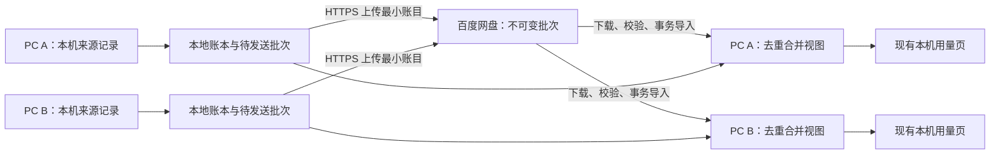

# remote-record：个人用量账本跨 PC 同步方案

本文件是本轮唯一状态与决策入口。日期：2026-10-13（Asia/Shanghai）。本地分支 `remote-record`，起点 `17b8fc0c3432acc3eca7d4b325165c9ed782022f`（QuoDex 0.4.2）。

**方案与效果图：Acceptance pending。产品同步能力：Not built。** 本轮只研究、设计和更新文档，不运行真实网盘上传，不修改产品源码。构建、产品测试、双 PC 往返和原生产物截图尚未执行，不能把这份报告当作产品验证通过。

## 已确认的产品合同

- 用户与环境：同一人独立使用多台办公 PC 上的 QuoDex，保留 Windows 11 / macOS 的现有产品边界；不希望维护常驻服务。操作系统组合及百度网络可达性在实施验收时记录。
- 范围：Codex + ZCode 所有加入电脑上仍可采集及已入账的 token 历史，合并为个人账本，不按供应商账号拆分。不能恢复所有设备均已删除且从未入账的历史，不等于官方账单或剩余额度。
- 已选传输：百度网盘官方 API、用户自有“个人使用”应用。用户接受一次开发者认证和应用配置；每台 PC 独立网盘授权。允许远端保存匿名请求标识、时间、token 等最小账目，不要求首期端到端加密。
- 展示：全部设备采用 Asia/Shanghai 日期边界；正常在线约一分钟发起自动同步，失败退避。离线保留已知总量和各机最后上传时间，恢复补齐；一分钟是调度目标，不是百度 SLA 或历史导入完成时限。
- 冲突：各 PC 通常独立使用；仍须防重复。相同已验证请求身份出现无法排序的不同计数时，保留冲突证据、从全部设备合计暂时排除，显式显示不完整及排除数量。
- UI：用户选择方向 A，扩展现有用量页，新增“全部设备 / 本机”及同步详情，保留液态玻璃、热力图、趋势和合并/分开模式。效果图尚待审核。

核心旅程只有三个：① 首台配置百度个人应用并授权，其他 PC 连接同一空间；② 各台正常采集，自动上传/下载，最终显示一致的去重总量；③ 断网、凭据失效或记录冲突时继续本机记账，保留有效历史，说明原因并恢复。

首期不做：自建后台、公开账号体系、共享团队账本、多个网盘适配器、套餐/费用推算、聊天内容同步、远程任务管理、自动删历史与远端垃圾回收。关闭同步只停止后续传输并保留账本；首期不提供会抹除历史的设备删除按钮。

## 三个子代理的代码级调研

| 子代理 | 深入项目（本轮 GitHub stars 快照） | 实读重点 | 结论与证据 |
| --- | --- | --- | --- |
| research_usage | ccusage 18,986；CodexBar 22,427 | Rust Codex parser/replay、ZCode loader；Swift request ledger、SSH export、CloudKit engine | 借鉴请求身份与争议小计，不能照搬来源过滤或 iCloud；[报告](usage.md) |
| research_sync | Joplin 56,706；Syncthing 89,343；Actual 29,463 | 对象上传/列表、锁、版本向量、冲突副本、事务日志/HLC | 借鉴对象传输和事务收件，直接文件覆盖不会合并数据库；[报告及网盘官方接入核实](sync.md) |
| research_backend | PocketBase 61,384；PostgREST 27,711；Supabase 111,443 | 批量事务、权限规则、JWT、SQL upsert；Supabase API 实现追到 PostgREST | 无中心计算需求，自建/托管数据库均比本轮需要更重；[报告](backend.md) |

共 7 个项目有实现源码深读，Supabase 另核查平台文档并追踪独立 PostgREST 实现；LiteLLM 仅初筛，不算深读。各报告列出固定 commit、源文件/函数、license、近期维护活动、安全边界和适配成本。stars 随时间变化，不代表安全审计通过；没有运行上游测试。

选择：**百度作文件存储，QuoDex 作请求账本合并**。借鉴 Joplin/Actual 的传输和事务思想、CodexBar 的请求合并；不引入其完整引擎，不复制 AGPL 代码。淘汰当前阶段的 PocketBase/PostgREST 常驻服务、CloudKit 平台绑定及必须重叠在线的纯 P2P。坚果云配置较少、OneDrive 原生 OAuth 更完整，但用户已明确选择百度；首期不会顺手实现多后端框架。

## 数据流与最小架构

继续使用 Rust + rusqlite。采集来源、传输状态、合并视图分开，但不拆成独立服务。新增一个同步编排模块和一个百度适配模块即可；不预建插件系统、通用事件总线或多后端抽象。原用量 HTTP 服务仍仅监听 loopback，网盘凭据留在 Rust 与 OS 安全存储，不交给浏览器页面。

应用内 SQLite 每台独立；绝不相互覆盖运行中的数据库。只传输稳定请求账目，不能相加多个 `daily_totals` 或整个设备累计。安全备份与跨设备合并是两回事。[SQLite 官方说明](https://www.sqlite.org/howtocorrupt.html)

### 三种身份必须分开

- `space_id`：一个个人账本空间，所有加入的电脑一致；不是供应商账号 ID。
- `device_id / writer_epoch`：显示设备及标识本次写入流，随机生成，不依赖主机名或绝对路径。每次同步进程启动采用新随机写入 epoch，持久化的未发批次保持原名重试；对象名另含随机批次 ID，备份回滚或克隆不得覆盖云端对象。
- `event_key`：同一业务请求的稳定身份，去重时不能加入设备 ID；否则复制记录会重复计费。远端只存空间域下的规范化摘要，不上传聊天标题、项目路径或原始 ID 字符串。随机高熵源 ID 的摘要是匿名化手段，不承诺抵御所有关联分析。

### 当前代码里的两个前置根因

1. `usage_service.rs` 的 Codex 键为 `codex:{thread_id}:{response_id}`，ZCode 键为 `zcode:{本机绝对路径哈希}:{id}`；后者不能作为跨 PC 请求身份。相同路径不能证明同一数据库，不同路径不能证明不同请求。需要版本化的新键，保留旧键映射用于迁移；不能直接 SQL 截字符串去掉前缀发布。
2. `usage_ledger.rs` 的 Codex 冲突只比较 total 并保留先到值，ZCode 则以最近扫描值覆盖。跨设备逆序到达会使副本分叉；本机 `updated_at_ms` 只是观察时间，不是来源版本。完整 token 向量相同而 total 相同的情况也必须区别检查。

Codex 可借鉴长度前缀编码的 `(source, original thread_id, response_id)`；需以 fork、归档复制、压缩记录验证 thread 身份。ZCode 上游 reader 使用 `model_usage.id` 去重，但本轮未取得其生成逻辑，也未证明跨安装唯一性、source revision 或完成后的不可变性。**实施第一关必须验证原生来源身份；不满足时不能宣称可靠全量跨机账本。** 用户常规独立使用减少冲突概率，不代替身份论证。

### 对象与导入协议草案

固定发现入口为 `/apps/<官方应用目录>/QuoDex/space-v1.json`，内容含唯一 `space_id`、协议版本和最低读写协议要求；对象才放在其指向的 `<space_id>/` 目录。新 PC 必须先读取固定入口，不能各自创建随机空间。首台用不覆盖语义创建；竞争失败者读取赢家配置。必须校验百度实际返回路径；自动重命名、多份入口或配置冲突均报错，不自动挑一份。若真实 API 不能可靠排他创建，则首台完成配置后才允许第二台加入。

批次使用 `objects/<随机前缀>/<batch_uuid>.json.gz`；对象名永不复用。封装包含协议版本、空间、写入 epoch、批次 ID、内容校验值、记录数量和账目。单条账目包含来源、请求摘要、UTC 原始请求时间、原有 total/input/output/cache/reasoning 计数、稳定 `observer_id`、`observation_id`、同一请求该观察者的 `predecessor_observation_id`（首条为空）、观察序号，以及确有证据时才填的来源版本。观察 ID 对规范化身份/前驱/计数求摘要，重传同一观察不新建身份。不同字段不重复加总，尊重现有来源口径。缓存和推理为细分，不再次加进 total。

具体顺序：

1. 本机采集变化与 outbox 写入在同一 SQLite 事务；一条没有变化的记录不会反复发出。历史首导从账本出发，包含来源应用已删除但 QuoDex 保留的旧记录。
2. 完成封装和持久化后上传，采用不覆盖策略；成功回包丢失时重试原对象并校验内容。对象确认前不清空 outbox。
3. 列表逐页读取，下载未知对象；校验空间/schema、内容完整性、数量、整数范围、解压大小及来源字段后，在同一事务应用观察记录和 inbox 标记。任何解析/写入失败不推进导入进度。
4. 重复下载无副作用，接收到的外机记录不会再次作为“本机新采集”上传。首次导入和重启恢复均可继续；不能只记最大序号跳过缺口。
5. 有变化才传输；未上传量、上传和拉取成功时间分别记录。设备状态写入单独小元数据，界面昵称使用“设备 A”等别名，不自动上传 hostname。列表刷新成功不等于所有离线设备均已上传。

遇到高于本机能力的空间协议或对象 schema，暂停该空间的远端读写，继续本地采集并积压 outbox；保留此前汇总并明确标记过期/不完整，要求升级。不允许旧客户端继续写旧格式却显示同步成功。正常坏对象可保留有效历史并报部分失败，但未知协议不能当作普通坏行跳过。

百度列表为 offset 分页，并发增加可能移动分页边界。因此不得把一次分页扫描作为永久游标：按不可变 ID 去重、补扫活跃前缀、周期全量核对；首次历史导入要求可重启全量扫描和稳定一轮核对。分区减少目录规模，却不是性能保证；已封闭分区须有可靠封闭约定才能停止复扫。具体前缀/目录索引优化在真实年度规模试验后决定，不能首期假设 listing 永不截断或漏项。

批次建议先以 1,000 条/1 MiB 未压缩为上限起点，遇两者任一先到就封批；这只是待测参数。网络响应、JSON 行、压缩后和解压后体积都设上限；超过限制保留待处理与诊断，不能悄悄丢记录。首次导入 O(N) 请求身份信息不可省略；先呈现本机统计，注明历史仍在同步。

### 更新与冲突收敛

写入 epoch 只隔离传输对象；稳定 observer 与每请求前驱链跨正常重启持久化。同一 observer 的新观察必须指向原请求上一个观察，并与 outbox 一起事务保存；接收者以已知祖先关系接受后继，不凭序号大小或时间获胜。缺前驱时暂存、补取并标记未完整；同一前驱有两个不同后继时按分叉争议排除，不任选一支。新安装使用新 observer；备份恢复或整机克隆产生相同 ID 也不能凭身份本身压过分叉。来源权威 revision 可在确有证据时裁决跨 observer 修正，否则比较各观察链有效末端。摘要只证明内容关系，不对可信网盘成员提供额外防伪保证。

对已验证身份相同、规范化 payload 相同的请求只计一次；不同 writer 的最新观察不一致且无权威顺序时，保存候选、标记争议、全部设备视图暂时排除该请求。不按最大 token、云端修改时间或“最后收到”猜结果。同一采集者合法修正与不同采集者争议分开：前者更新该采集者观察，后者只有后续可靠来源证据或各有效观察收敛后才解除。冲突处理不删除原始账目；本机范围保留本机值，全设备范围注明排除数量。

迁移采用版本化 schema、SQLite 一致备份和旧账目保留，完整事务后切换；原始来源已删除的旧记录，如无法证明新身份映射则保留为“历史身份待确认”，显示排除数量，不擅自合并或丢弃。冲突和身份不明都意味着不完整小计，不允许绿色“完整总量”。

## 百度接入与凭据

用户已选择自用应用路线，以下是未来实施步骤，本轮不要求填写真实密钥：

1. 用户在百度官方开放平台完成个人开发者认证，创建“个人使用”应用，记录 AppKey、SecretKey 与官方应用目录/权限信息。官方目前允许个人或小范围不超过 10 人免上线审核；这指使用人数，不等于已验证任意 PC 数量或公开发布资格。[审核指南](https://pan.baidu.com/union/doc/使用入门/应用上线审核/应用上线审核试运行/)
2. 每台 PC 在 QuoDex 二级“管理连接”填入同一自有应用配置，并通过百度官方设备码页独立授权同一网盘。自有 SecretKey 不写安装包、不写仓库、不在普通偏好或日志落盘；Windows 使用凭据安全存储，macOS 使用 Keychain，具体库需实施时验证。官方授权周期与权限以实际返回为准。
3. 每台独立保存 refresh token，不同步它。设备码授权文档说明换取/刷新需要 client_secret，refresh token 单次使用，新的刷新响应需原子持久化；同机刷新互斥，崩溃后旧 token 已失效则提示重新授权，不能承诺无条件静默恢复。[设备码模式](https://pan.baidu.com/union/doc/使用入门/接入授权/设备码模式授权/)
4. “连接”按钮一次提交完成校验与首次同步；按钮旁明确告知会向网盘上传最小账目，拒绝重复低风险确认。其他设备无需部署服务，但仍需配置自己的授权；本轮不伪装为现成“一键百度登录”成品。

独立保存 token 不证明百度允许同一用户与 AppKey 的多设备授权互不失效。真实接入必须验证 A 授权→B 授权→A/B 交替刷新→一端重新授权后另一端继续有效；若失败，百度路线在本需求下不得放行，也不通过偷偷增加 token 中转服务器解决。需重新和用户讨论可用授权模式或存储选择。

列表→取下载链接→下载有额外请求；链接约 8 小时有效且敏感。API token/下载 URL 不进命令行、日志或页面，错误输出脱敏；重定向只到官方允许的下载端点，禁止将凭据转发到任意主机。官方频控数字未公开，接口基础费用和特定账号权限尚未实测。[下载说明](https://pan.baidu.com/union/doc/基础网盘服务/下载/)

首期只做 HTTPS 和 OS 凭据保护，不把“允许最小账目”扩展成同步聊天/路径/API key。网盘可读取这些最小账目，文件 hash 是完整性校验而非防恶意网盘的认证；持有网盘写权限者属于信任边界内。暂不加入用户未要求的 E2EE 密钥配对系统。共享 AppSecret 与同一网盘意味着不能仅删除 UI 设备行就声称撤销远端写权限；停用需要在百度端撤销相应授权/必要时轮换密钥，其他 PC 可能需重新连接。

## UI 与故障行为

见 [UI 说明](ui-brief.md)、[统计页五态图](ui-review.png) 和 [百度连接流程图](connection-review.png)。图片由内置 imagegen 生成，示例数字和日期只用于视觉审核；精确文本与交互合同以文档为准，不是运行截图。生成图里的浏览器装饰、局部文字或重复控件不构成功能承诺；实施前应按下面合同清理并由用户确认最终效果。

- 首屏：统计总数、来源分项、日期范围、全部设备/本机选择；保留原来的来源合并/分开模式。设备详情入口始终可见，不常驻大设备列表。
- 处理中：保留已有读数，显示已导入记录与待上传条数，无虚构百分比。
- 成功：“本轮同步完成”，另显示各设备最后上传时间；设备离线未传数据仍未知。
- 失败：保留账本、可行动原因、稳定诊断码和重试；后台按服务端 Retry-After 或指数退避处理瞬时故障，鉴权失效引导重新授权，不疯狂重试。
- 窄屏：单列分项、热力图可用、选择控件不重复、无整页横向滚动；设计图是首屏示意，最终需真实产物截图验证。

建议诊断命名（需实施时检查全仓冲突再登记）：QDS-101 网络、QDS-102 授权失效、QDS-103 限流、QDS-104 空间不足、QDS-105 内容/协议不兼容、QDS-106 请求冲突、QDS-107 空间不匹配、QDS-108 历史身份待确认。失败须说明已保留什么数据、何时自动恢复或用户应执行哪一步，不能全部翻译成“同步失败”。

连接流程图覆盖应用说明/AK-SK输入、官方设备码授权等待、连接成功和授权失败，同样等待审核。它属于 Tauri 应用二级设置窗口；输入值仅短暂经过该受限窗口传给 Rust，不进入用量网页、网页存储或页面日志。图中“不上传密钥”指不把密钥作为账本文件上传或同步；SecretKey 仍按官方协议发送到百度授权端点，正式文案应写“密钥仅用于百度授权，不随账本同步”。

## 实施顺序与可复现验收

批准方案后另进入实现，按小步验证推进；本轮没有产品测试通过记录。

| 关卡 | 工作与证据 | 放行条件 |
| --- | --- | --- |
| 1 身份与旧账迁移 | 追到来源 ID 生成/使用逻辑；两独立安装、日志复制/fork、ZCode修正、源已清理的匿名 fixture | 明确唯一键与版本边界，迁移可回滚、旧账不丢；不能用本地路径或时钟凑键 |
| 2 纯本地合并 | 两套干净数据目录、确定性去重及 outbox/inbox 故障注入 | 重复/逆序/重启结果相同；原记录失败不会标为已发送；不读取真实聊天内容 |
| 3 百度最小往返 | 用户配置测试应用，专用测试空间上传/分页列举/下载、A/B交替刷新与重新授权、限流和损坏对象 | 真实 API 往返、权限及多设备授权不互踢确认，记录版本、环境、步骤、实际响应摘要；不在日志写密钥 |
| 4 UI 接入 | 用户审定统计页及连接流程图后实现 | 构建、相关测试、启动冒烟通过；真实产物桌面/窄屏/故障截图对照获批图 |
| 5 双 PC 端到端 | 两台真实 PC 与干净 QuoDex 数据目录，匿名合成来源记录 | 同步前后结果、网盘已存批次、离线补传、重启均有证据；用户手工验收 |

必须跑的判定样例：

1. A 独有请求 100，B 独有请求 200，两端同步后均为 300。再同步/重启十次仍为 300，不以测试次数代替覆盖。
2. A/B 同一已验证请求 80，再加各自 100/200，合计 380；不能算 460。同键不同向量 80/90：争议 1 条排除，已知小计 300，双方一致。
3. 同一 ZCode 请求从 100 修正到 180：可靠同源版本只保留 180；B 逆序重放 100 不得覆盖为 100。缺来源版本时按已确认争议策略，不静默 max。
4. A 离线新增 50，B 在线新增 70；恢复并上传后双方一致且新增合计 120。离线期间页面显示过期信息，不声称完整。
5. 上传成功响应丢失、下载导入事务崩溃、refresh token 写入中断、两客户端同时写：重试不重计，失效凭据给明确恢复步骤。
6. API 多页和分页期间新增、缺失/损坏批次、未来 schema、恶意大压缩包：不漏读后续页，不推进失败游标，不清空本地账本。
7. 同一 UTC 请求在 15:59:59Z/16:00:00Z 跨上海午夜：所有 PC 无论系统时区按相同日期划分；夏令时/设备时钟不会排序业务修正。
8. 新 PC 首导既有完整历史；源应用清理历史、网盘文件短暂不可见或用户断开同步，不抹去已入账历史。匿名年度规模 fixture 测试请求量、内存和同步延迟，超限清楚报告。

验收报告须区分源码构建、合成协议测试、真实百度接口与双 PC 旅程。需要记录源码 commit、构建产物、OS/QuoDex/源应用版本、干净目录、步骤、实际数值、截图及已知限制。未做任何一项不得报全绿。

## 本轮证据与下一步

已执行：PowerShell 7.6.5 环境检查；Git 工作区/分支检查并创建 remote-record；阅读项目规范、scripts、README、相关 ADR 和实际统计源码；3 个子代理进行公开 GitHub 固定版本源码与官方网盘文档研究；用户决策已写入本方案与领域术语；生成方向 A 五态视觉稿。

未执行：产品构建、测试、启动冒烟、真实网盘读写、双 PC 同步和性能测试。没有新的构建产物；图是设计稿，不是 UI 运行证据。最终提交前只对本轮文档做链接路径/空白/改动范围检查，结果通过交付消息说明。

下一步是用户审核本方案、统计页和连接流程效果图。通过后先验证 ZCode 身份、百度个人应用实际权限与多设备授权，再实施；尚未因为方案获批而自动授权公开发布、上传代码、创建远程或 push。
