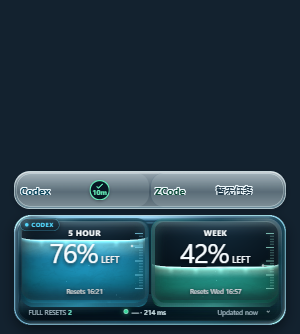

# Windows 任务详情关闭后的透明区输入

整体状态：**Acceptance pending**。最终本地安装产物与真实任务场景均为 **Verified**，等待用户按原操作验收。验证日期：2026-10-12。

来源为官方 `v0.4.2`，基线 `59c9529f56978d1a3667fc83055013fc72d5d797`，本地分支 `fix/windows-task-detail-click-through`。这是 v0.4.2 Windows 本地修复版，版本号仍为 0.4.2；未发布远程版本。

## 根因与修复

v0.4.2 常驻预留任务详情空间，但自动输入区域更新仅实现了 macOS 路径，Windows 原来直接返回成功。详情关闭后，透明像素仍在原生矩形窗口内部，鼠标输入被截住。[官方安装版复现](official-baseline.json)中，两次下方原生窗口的点击计数都为 1→1，尽管采样像素与背景一致。

Windows 现在依据前端已存在的可见区域与圆角判断输入，转换实际 DPI 坐标，切换原生穿透状态；保留已开始的拖动，并处理手动穿透超时。低级鼠标监听转发全部输入，不记录全局事件。后台悬停恢复补齐 Windows 视口坐标及窗口归属检查；光标离开或进入穿透状态时清除旧标志。稳定输入诊断为 `QDT-634`。

## 环境与实际结果

Windows 11 x64，内核 `10.0.26200.0`，DPI 96（100%），PowerShell 7.6.5、Node 24.18.0；固定 WebView2 `151.0.4129.78`。

| 检查 | 状态 | 结果与证据 |
| --- | --- | --- |
| 构建 | Verified | TypeScript、Vite、Rust release、NSIS 安装包构建成功。[输出](checks.txt) |
| 前端 | Verified | 13 文件、172 项通过；新增悬停恢复及离开后清除标志的回归。[输出](checks.txt) |
| Rust / 静态检查 | Verified | 140 项通过，4 项环境相关测试忽略；Clippy `-D warnings` 通过。[输出](checks.txt) |
| SQLite 夹具 | Verified | 2 项通过；原生输入场景使用隔离 SQLite 和 Desktop 协议夹具。[输出](checks.txt) |
| 安装产物输入 | Verified | 一次移到窗口内部透明边缘关闭详情，一次移出窗口关闭；两次透明区首次点击分别为 1→2、2→3。零等待控件点击未泄漏；10 秒手动穿透及恢复、拖动捕获及释放后穿透通过。[点击](installed-input.json)、[场景](installed-checks.json)、[控件](installed-control-clicks.json) |
| 真实用户任务 | Verified | 正常配置启动的实际安装程序，真实任务两次悬停、离开、首次点击均为 1→2、2→3。[匿名记录](live-input.json)；不保存真实标题、标识符或账户载荷。 |
| 透明绘制与设置 | Verified | 红、绿、蓝三个原生背景 × 紧凑、设置打开、恢复，共 9 个样本通过；窗口高度 334→498→334。[像素与截图索引](transparency.json) |
| 原位安装 | Verified | 安装退出码 0，安装前后配置目录 3 个文件的内容指纹一致；二进制与构建产物除 Tauri 的 `UNK`→`NSS` 包类型标记外逐字节一致。[安装](installation.json)、[二进制](binary-identity.json) |
| 正常启动与快捷方式 | Verified | 实机检查后应用仍在运行且窗口可见；桌面快捷方式指向当前安装，卸载登记仅有一个 QuoDex 0.4.2。[记录](running-installation.json) |
| 用户验收 | Acceptance pending | 悬停任一真实任务 → 移开关闭详情 → 点击原详情所在的上方透明区域中的其他应用；确认第一次点击生效，同时额度仓和任务控件可用。 |



## 产物与复现

安装包：`release/QuoDex-0.4.2-win-x64-local-input-fix-setup.exe`，SHA-256：`9b0bae47b9dca147e90292c9513b9511c2a6ec163276315a9dfb5583dffaec3a`。

安装路径：`%LOCALAPPDATA%\QuoDex\codex-credits-view.exe`，SHA-256：`3fbfd166eb846a82266bbb764fb73d9bd068824029317d58ae654b27644c5eb8`。

在仓库根目录、可访问交互桌面的 PowerShell 7 中运行；原生场景会短暂显示测试背景，并自动退出测试实例、恢复快捷方式。

```powershell
npm.cmd test
npm.cmd run test:native-fixtures
cargo test --manifest-path src-tauri/Cargo.toml --locked
cargo clippy --manifest-path src-tauri/Cargo.toml --locked --all-targets -- -D warnings
$env:QUODEX_EXECUTABLE=Join-Path $env:LOCALAPPDATA 'QuoDex/codex-credits-view.exe'
$env:QUODEX_TASK_REVIEW_DIR='.scratch/windows-input/recheck'
node.exe scripts/verify-task-status.mjs --input-only
pwsh.exe -NoProfile -File scripts/transparency-native.ps1 -Executable $env:QUODEX_EXECUTABLE -OutputDirectory .scratch/windows-input/colors-recheck
# 对已正常运行的实例，替换下面的实际进程 ID；不启动夹具。
node.exe scripts/verify-live-task-input.mjs <QuoDex-process-id>
```

## 限制与验证中的纠正

仅实测本机 100% DPI；不同缩放、多屏和 macOS 未复测。4 个忽略项涉及特定 Desktop/ZCode 实机状态或账户，本次未将它们标记通过。输入夹具不能证明真实聊天跳转或等待批准流程。

初版候选存在冷启动悬停恢复失败，已撤销无效的原生消息重放并补齐既有恢复链路；此处证据全部来自最终安装产物。三色脚本首次像素检查通过，但未激活窗口的立即右键使设置开合检查失败；激活窗口并等待输入交接后，开合和全部像素样本通过。零等待首次点击仍由独立原生接收窗测试。修改的两个 Rust 文件格式检查通过；全仓 `cargo fmt --check` 还会报告基线未改文件的既有格式差异，不列为通过项。
